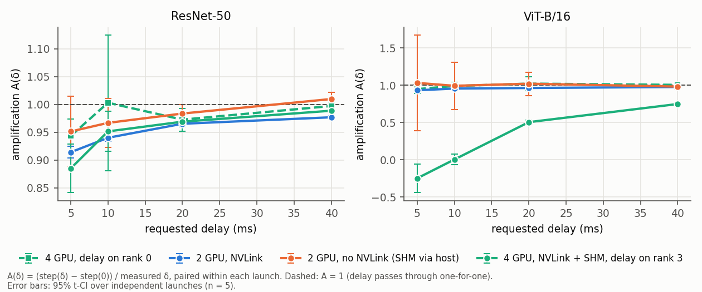
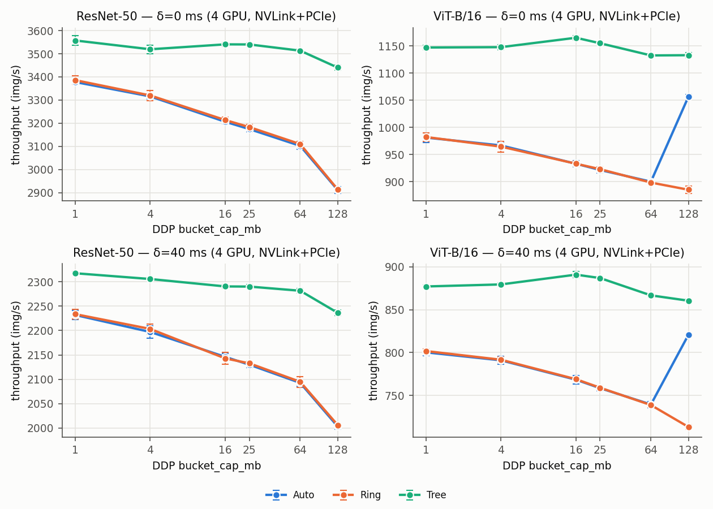
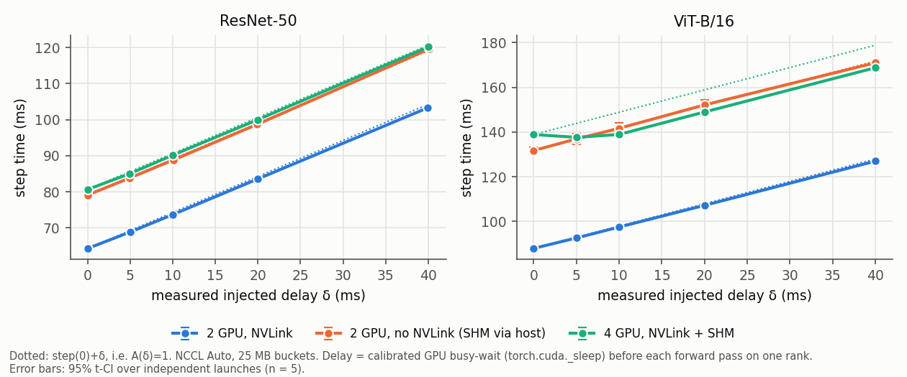

# hetero-ddp-lab

A measurement study of what happens to synchronous PyTorch DistributedDataParallel (DDP) training when
**one GPU is slower than the others**, on a single 4-GPU NVLink + shared-memory host.

In synchronous data parallelism every training step ends with gradient all-reduces that need all ranks, so
the job runs at the pace of its slowest rank. DDP hides part of this communication behind the backward pass
by grouping gradients into buckets (`bucket_cap_mb`), and NCCL picks a collective algorithm (Ring, Tree, or
its own choice, "Auto"). This repository asks:

- **H1.** Does a delay on one rank get *amplified* by synchronization, i.e. does the step time grow by more
  than the delay?
- **H2.** Does the DDP bucket size change how sensitive training is to that delay?
- **H3.** Does the configuration that is fastest on equal GPUs stop being fastest when one GPU is slow?

It is an exploratory characterization of one host, one topology, two workloads and one synthetic delay
model. It does not propose a new algorithm and makes no novelty claim.

## Setup
- **Hardware.** 8× NVIDIA RTX A6000 (48 GB, 300 W default power limit) in a 2-socket AMD EPYC 7713 server.
  Only GPUs 0-3 (one NUMA node) were used, because the machine is shared. GPUs 0-1 and 2-3 are NVLink
  bridge pairs; the pairs are connected through PCIe.
- **Transport.** NCCL's default PCIe peer-to-peer path between GPUs 0 and 2 returned a **wrong all-reduce
  result** on this host (cause not diagnosed; IOMMU/ACS settings are a plausible, NVIDIA-documented
  candidate). All runs therefore use `NCCL_P2P_LEVEL=NVL`: NVLink pairs use P2P, every other path uses
  NCCL's shared-memory transport through host memory (SHM). The 2-GPU "no NVLink" setting is SHM, not
  PCIe P2P.
- **Settings.** 2 GPUs over NVLink (0,1); 2 GPUs over SHM (0,2); 4 GPUs (NVLink pairs joined by SHM).
- **Workloads.** torchvision ResNet-50 (batch 64 per GPU) and ViT-B/16 (batch 32 per GPU), bf16 autocast,
  fixed synthetic inputs (no data loading).
- **Software.** Python 3.13.12, PyTorch 2.6.0+cu124, CUDA 12.4, NCCL 2.21.5, driver 580.173.02.
- **Design.** 60 launches, 810 conditions: bucket sizes 1-128 MB × delays 0-40 ms × NCCL Auto/Ring/Tree
  on 4 GPUs, plus delay sweeps on the 2-GPU settings and a control with the delay on rank 0. Each condition
  runs in 5 independent launches (`torchrun` process groups) in randomized order; each launch measures its
  own δ = 0 baseline, so delay effects are paired within a launch.

## How the controlled delay works
One rank (rank 3, or rank 0 in a control) runs a GPU spin kernel, `torch.cuda._sleep(cycles)`, on its
compute stream before every forward pass. The host is not blocked; later kernels queue behind the spin. The
number of cycles is recalibrated during warmup so that the measured delay matches the requested 5, 10, 20
or 40 ms (mean error < 0.8%), and the actual delay is measured with CUDA events every step. All results use
the measured δ.

This is a **calibrated busy-wait, not a slower GPU**. It shifts the delayed rank's whole step; a genuinely
slower or power-capped GPU would stretch every kernel, including the backward kernels that interact with
bucket readiness. A power-cap experiment is implemented but could not run (no permission).

The key metric is the amplification factor **A(δ) = (step(δ) − step(0)) / δ**, paired within a launch:
A = 1 means the delay passes through one-for-one, A > 1 amplification, A < 1 partial absorption.

## Main observations
Mean ± 95% t-CI over 5 launches (4 for 4-GPU ResNet-50 Ring). Details, all tables and the remaining
figures are in [`docs/results.md`](docs/results.md).

1. **No systematic amplification (H1).** In all 112 tested cells A lies between −0.25 and 1.03; the delay
   usually passed into the step time almost one-for-one (A ≈ 0.94-1.0). It was partly absorbed only when
   the delayed rank already had measured idle time ("slack"): with the delay on rank 3 of the 4-GPU ViT
   runs, A = 0.004 ± 0.069 at δ = 10 ms and 0.748 ± 0.016 at δ = 40 ms, while the same delay on rank 0 gave
   A ≈ 1.0. One cell is nominally above 1 (A = 1.010 ± 0.012); with 112 correlated, uncorrected
   comparisons some nominal false positives are expected, so this does not establish amplification.
2. **Bucket size matters for ViT-B/16, little for ResNet-50 (H2).** A repeated-measures ANOVA (launch as
   subject, Greenhouse-Geisser corrected, Holm-adjusted over 16 cells) finds a bucket-size effect on A in
   all 8 ViT cells but in only 2 of 8 ResNet cells, where A varies by just 0.02-0.09. For ViT with NCCL
   Auto, the large jump at 128 MB coincides with NCCL switching most of those all-reduces from Ring to Tree,
   so it is not a pure bucket-size effect.
3. **The fastest configuration stayed the fastest (H3), and NCCL's own choice was not the fastest.** Within
   the tested matrix, the configuration with the highest throughput at δ = 0 showed no detectable loss at
   δ = 10 or 40 ms (largest regret 0.08%, Welch p = 0.70). Forcing Tree beat NCCL Auto at every delay
   (+5% ResNet-50, +10% ViT-B/16 at δ = 0); Auto chose Ring for almost all bucket all-reduces here.

A side observation: on the 4-GPU ViT runs, compute kernels took 17-20% longer while NCCL kernels were
running concurrently. Contention is a plausible explanation, but it was not isolated experimentally.

## Selected figures

*Amplification A(δ) at NCCL Auto and 25 MB buckets. Dashed line: A = 1. Error bars: 95% t-CI over
independent launches (n = 5). Dashed line with square markers: control with the delay on rank 0, which has
no measured slack and gives A ≈ 1.*


*Throughput of NCCL Auto, Ring and Tree across bucket sizes on 4 GPUs, without delay (top) and with a
40 ms delay (bottom). Error bars: 95% t-CI over launches (n = 4-5).*


*Step time against the measured delay; dotted lines show step(0) + δ (A = 1). Error bars: 95% t-CI over
launches (n = 5).*

## Key limitations
- One host, one GPU model, 2-4 GPUs, two workloads with synthetic inputs; no multi-node or NVSwitch results.
- A synthetic pre-forward delay at one or two rank positions, not a genuinely slower GPU.
- Non-NVLink communication used NCCL's SHM transport because PCIe P2P failed on this host.
- Mechanisms (contention, BatchNorm buffer broadcast, lower power while waiting) are inferred from
  profiles and timing, not isolated by control experiments.
- Energy is NVML GPU-board energy only (no CPU, DRAM, network or storage); NVML sensors are coarse, and the
  software power-limit policy constrained clocks in almost every window.
- The profiler-based concurrency metric counts NCCL kernels that wait for peers; it is not a measure of
  hidden data transfer.
- The machine was shared. Contaminated attempts were detected and excluded whole; one launch
  (ResNet-50 Ring, trial 1) has no clean attempt, so 792 of 810 conditions are available.

Full list: [`docs/limitations.md`](docs/limitations.md); review notes:
[`docs/scientific_validity.md`](docs/scientific_validity.md).

## Reproducing the analysis
Analysis, figures and tests run on any machine with Python 3.13 and no GPU:

```bash
python -m venv .venv && source .venv/bin/activate     # Windows: .venv\Scripts\activate
pip install -r requirements-analysis.txt
python -m hddp.analyze --stage final            # raw JSONL -> results/processed/final_*
python -m hddp.analyze --stage pilot
python -m hddp.figures --stage final            # -> results/figures/ (add --outdir DIR to write elsewhere)
python scripts/check_reproducibility.py         # re-runs the analysis in a temp dir and compares
python -m pytest                                # parsing, statistics, data invariants, privacy, safety
```

Re-running the GPU experiments needs Linux, NVIDIA GPUs and `requirements-experiment.txt`. The stages are
`python -m hddp.env --gpus 0,1,2,3` (characterization and P2P correctness probe), then
`python -m hddp.run smoke | pilot | verify | final`; each `hddp.run` stage accepts `--dry` to print its plan
without touching the GPUs or any file. The full command sequence is in methodology §12
([`docs/methodology.md`](docs/methodology.md)).
The published raw data were redacted with `scripts/sanitize_data.py` (host and user identifiers,
timestamps); no measurement was changed, and the processed tables regenerate identically.

## Repository layout
| path | content |
|---|---|
| `hddp/` | `worker.py` (DDP worker, delay, timing, NVML, profiler), `run.py` (orchestrator), `env.py` (topology, P2P probe), `analyze.py` (tables, statistics), `figures.py`, `nvml.py`, `privacy.py` |
| `results/raw/` | JSONL records per stage, logs, archived NCCL logs (source of truth) |
| `results/processed/` | trial and condition tables, H2 tests, NCCL verification, summaries |
| `results/figures/` | all 13 figures |
| `docs/` | [results](docs/results.md), [methodology](docs/methodology.md), [limitations](docs/limitations.md), [data dictionary](docs/data_dictionary.md), [scientific-validity notes](docs/scientific_validity.md) |
| `scripts/` | reproducibility check, data sanitizer, Nsight helper |
| `tests/` | automated tests |

## Related work
Stragglers in synchronous training and straggler-tolerant collectives are well studied, e.g. backup
workers (Chen et al., arXiv:1604.00981), partial collectives (Li et al., PPoPP 2020), tail-tolerant
all-reduce (OptiReduce, NSDI 2025), straggler diagnosis (FALCON, arXiv:2410.12588), DDP bucketing
(Li et al., VLDB 2020), communication scheduling (ByteScheduler, SOSP 2019) and compute slowdown under
communication overlap (Lee et al., ISPASS 2025). More references are in
[`docs/scientific_validity.md`](docs/scientific_validity.md).
